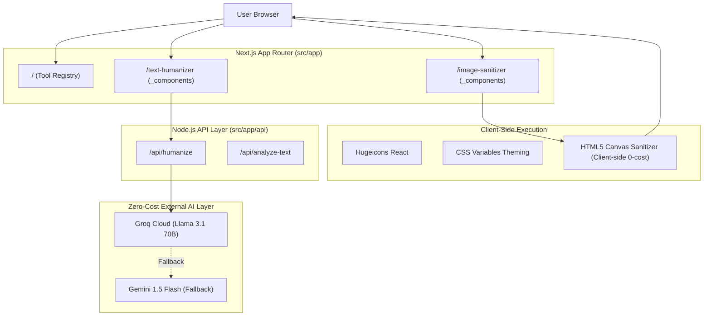

# Architecture & System Design — UnTraceMe

> **Created Date:** 2026-10-13  
> **Project:** UnTraceMe (`d:\SMT\untraceme`)  
> **Brand Vision:** Multi-tool AI trace & artifact remover suite (modular like iLovePDF)  
> **Business Model:** 100% Free AI tiers, zero server computing bills, monetized via Google AdSense.

---

## 1. Core Principles & Strict Rules

1. **Icons:** Use **Hugeicons** (`hugeicons-react`) throughout the application for a modern, sleek, non-generic look.
2. **Design Tokens & Theme:** 
   - All theme colors, border radii, shadows, and spacing must use **CSS Variables** defined in `globals.css` (Tailwind CSS v4 variable integration).
   - Clean, refined, non-generic aesthetic: Deep slate/zinc neutrals with subtle electric accents.
   - Clean typography with standard font scaling and full responsiveness across mobile, tablet, and ultra-wide displays.
3. **Modular Architecture:**
   - Every individual tool must be structured inside its own route containing a private `_components` directory:
     - `src/app/<tool-slug>/_components/...`
   - Common components, shared navigation, footer, and Ad slots live in `src/app/_components/` or `src/components/ui/`.
4. **Zero-Cost Compute Strategy:**
   - **Image Sanitizer:** 100% Client-side browser execution via HTML5 Canvas and Blob re-encoding. Zero server bandwidth or GPU cost. Strips EXIF, IPTC, XMP, and invisible C2PA synthetic markers.
   - **Text Humanizer:** Node.js API proxying requests to free-tier LLM endpoints (Groq Cloud LLaMA 3.1 70B / Gemini 1.5 Flash).
5. **Context & Audit Trail:**
   - Every completed phase or milestone must generate a documentation context file under `docs/` named with clear naming conventions and date stamp (e.g. `docs/context-<feature-name>-YYYY-MM-DD.md`).

---

## 2. Directory Hierarchy

```text
d:/SMT/untraceme/
├── docs/                                 # Context archives & architectural specs
│   ├── ARCHITECTURE.md                  # This master specification
│   └── context-<feature>-2026-10-13.md   # Completed task audit logs
│
├── app/                                  # Next.js App Router (Root app/, no src/)
│   ├── layout.tsx                        # Root layout, Hugeicons, CSS variables, SEO, Ad scripts
│   ├── page.tsx                          # Main Suite Dashboard (all tool cards grid)
│   ├── globals.css                       # Global CSS variables, custom utilities & tokens
│   │
│   ├── text-humanizer/                   # 🔹 Module 1: AI Text Trace Remover
│   │   ├── page.tsx                      # Text humanizer interface
│   │   └── _components/                  # Dedicated module components
│   │       ├── text-editor-pane.tsx      # Dual input/output panes with stats
│   │       ├── bypass-controls.tsx       # Aggressiveness & style selectors
│   │       ├── perplexity-meter.tsx      # Dynamic human probability indicator
│   │       └── text-toolbar.tsx          # Hugeicon-driven actions (Copy, Clear, Download)
│   │
│   ├── image-sanitizer/                  # 🔹 Module 2: Image AI Metadata Remover
│   │   ├── page.tsx                      # Image tool interface
│   │   └── _components/                  # Dedicated module components
│   │       ├── dropzone-pane.tsx         # Drag & drop upload area with Hugeicons
│   │       ├── metadata-badge-list.tsx   # Detected AI artifacts (Midjourney/DALL-E/C2PA)
│   │       ├── image-comparison.tsx      # Before vs After sanitization preview
│   │       └── sanitize-actions.tsx      # Re-encode, clean & download triggers
│   │
│   ├── api/                              # 🔹 Serverless Node.js Route Handlers
│   │   ├── humanize/
│   │   │   └── route.ts                  # Free AI engine pipeline (Groq / Gemini)
│   │   └── analyze-text/
│   │       └── route.ts                  # Perplexity / Burstiness metrics
│   │
│   └── _components/                      # 🔹 Shared / Suite-wide Components
│       ├── site-navbar.tsx               # Global navigation with Hugeicons
│       ├── site-footer.tsx               # Footer, privacy policy, TOS links (AdSense compliant)
│       ├── ad-container.tsx              # Adaptive Google AdSense banner placeholders
│       └── tool-card.tsx                 # Interactive dashboard suite cards
│
├── components/
│   └── ui/                               # Base UI primitives (Button, Card, Badge, Slider, etc.)
│
├── lib/                                  # 🔹 Core business engines
│   ├── text-engine/
│   │   ├── groq.ts                       # Groq LLaMA 3.1 70B integration
│   │   ├── gemini.ts                     # Google Gemini Flash fallback
│   │   └── prompt-builder.ts             # High-burstiness ghostwriting prompt
│   ├── image-engine/
│   │   ├── canvas-cleaner.ts             # Client canvas pixel scrubber
│   │   └── metadata-scanner.ts           # EXIF / C2PA header scanner
│   └── utils.ts                          # CSS variable class helpers (cn)
│
└── config/
    ├── tools-registry.ts                 # Central registry of tools (extensible like iLovePDF)
    └── site.ts                           # Metadata, SEO tags & Ad config
```

---

## 3. High-Level Data Flow



---

## 4. UI/UX Rules & Styling Specifications

- **Typography:** Standard clean font (`Inter` / `Geist Sans`), responsive scaling (`text-sm` up to `text-3xl`).
- **Icons:** Exclusive use of `@hugeicons/react` for consistency and premium tactile sensation.
- **Color Palettes via CSS Variables:**
  - `--background`: Background surface
  - `--foreground`: Text primary
  - `--card` & `--card-foreground`: Elevated surface
  - `--primary` & `--primary-foreground`: Refined accent
  - `--muted` & `--muted-foreground`: Secondary meta labels
  - `--border`: Subdued hairline dividers
  - `--radius`: Uniform border rounding
- **Ad Integration:** Dedicated, high-viewability banner slots that blend harmoniously without hindering usability.
